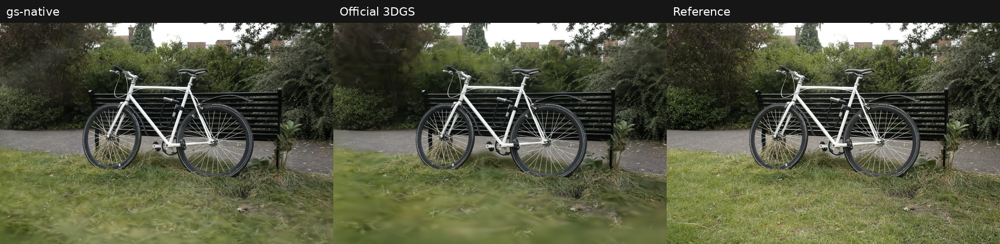
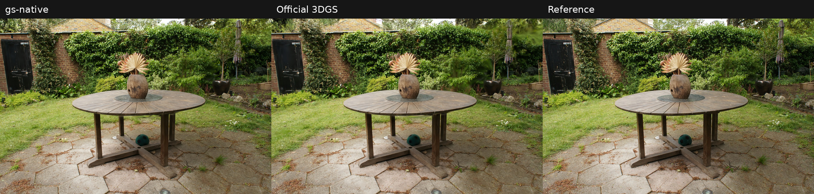
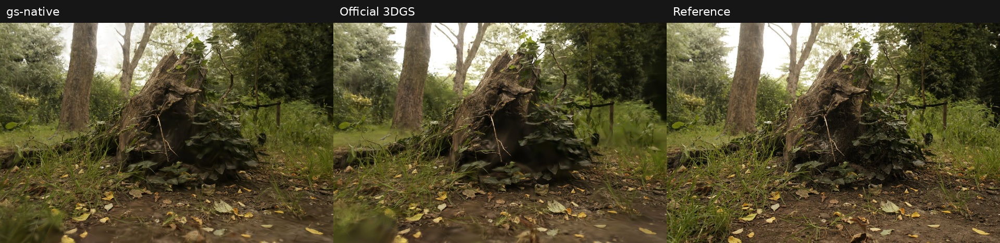

# gs-native

A C++17/CUDA implementation of 3D Gaussian Splatting, with one camera image per optimization iteration, analytic gradients, Adam updates, density control, and tile-based rendering.

The implementation follows the pipeline of [3D Gaussian Splatting](https://github.com/graphdeco-inria/gaussian-splatting). Gaussian rotations are stored as axis-angle vectors internally and converted to quaternions when exporting PLY files. The C++ namespace is `gs_native`.

## Performance and quality

The two comparisons below report measured results for each project under the listed configurations. Image resolutions, held-out views, and iteration counts are matched; detailed configurations are provided in the benchmark report. The results describe speed and reconstruction quality under these configurations and do not isolate the effects of implementation differences.

### gs-native vs. official 3DGS

Measured optimization speed ratios of **3.13x to 6.20x** versus the official Python 3DGS implementation across 11 historical runs. Each pair used the same scene, actual image resolution, held-out camera split, and a 30,000-iteration budget. Quality differences are reported below rather than assumed to be zero.

Left to right: **gs-native | official 3DGS | reference**. Both models use the same held-out view. Previews are resized equally for display.



**Bicycle:** More distinct foliage and grass structure; foreground grass still shows blur relative to the reference.



**Garden:** Clearer shrubs and ground texture in the matched view.



**Stump:** More distinct vegetation around the trunk.

| Scene | gs-native time | Official 3DGS time | Speed ratio | Delta PSNR (dB) | Delta SSIM |
|---|---:|---:|---:|---:|---:|
| truck | 252.127 s (4.20 min) | 788.970 s (13.15 min) | 3.13x | +0.2087 | +0.002201 |
| train | 205.840 s (3.43 min) | 655.577 s (10.93 min) | 3.18x | -0.5048 | -0.003910 |
| drjohnson | 376.533 s (6.28 min) | 1413.095 s (23.55 min) | 3.75x | -0.2122 | -0.002795 |
| playroom | 269.792 s (4.50 min) | 1041.503 s (17.36 min) | 3.86x | -0.0269 | -0.000022 |
| bicycle | 2008.770 s (33.48 min) | 9379.895 s (156.33 min) | 4.67x | +0.4900 | +0.018933 |
| bonsai | 574.646 s (9.58 min) | 3564.527 s (59.41 min) | 6.20x | -0.3469 | +0.000031 |
| counter | 728.755 s (12.15 min) | 3954.168 s (65.90 min) | 5.43x | +0.0401 | +0.000335 |
| garden | 2238.230 s (37.30 min) | 10005.353 s (166.76 min) | 4.47x | +0.6374 | +0.011936 |
| kitchen | 782.867 s (13.05 min) | 4395.360 s (73.26 min) | 5.61x | +0.1761 | +0.000812 |
| room | 748.896 s (12.48 min) | 4177.453 s (69.62 min) | 5.58x | +0.1036 | +0.000308 |
| stump | 1252.870 s (20.88 min) | 6833.404 s (113.89 min) | 5.45x | +0.5127 | +0.011923 |

**Speed ratio = official time / gs-native time. Delta = gs-native minus official.** Timings include optimization and density control, and exclude loading, initialization, saving, and evaluation. PSNR and SSIM use full-resolution floating-point evaluation, not the quantized PNG outputs of the render demo.

**Test platforms:** RTX 4090 (24 GB), Ubuntu 22.04, CUDA 12.4. The gs-native runs used NVIDIA driver 580.142. Detailed test conditions are provided in the benchmark report.

[Full 11-scene report: resolutions, camera counts, model sizes, absolute metrics, run provenance, and all matched-view previews](docs/benchmark.md).

### gs-native vs. gsplat v1.5.3

This is a separate paired comparison against [gsplat v1.5.3](https://github.com/nerfstudio-project/gsplat/tree/937e29912570c372bed6747a5c9bf85fed877bae), using the same 11 scenes, full image resolutions, held-out camera names, and 30,000 single-camera iterations. All runs completed and all final models passed the evaluation checks.

| Scene | gs-native time | gsplat time | Speed ratio | Delta PSNR (dB) | Delta SSIM |
|---|---:|---:|---:|---:|---:|
| truck | 252.127 s (4.20 min) | 985.690 s (16.43 min) | 3.91x | +0.4713 | +0.007829 |
| train | 205.840 s (3.43 min) | 587.017 s (9.78 min) | 2.85x | +0.9873 | +0.007375 |
| drjohnson | 376.533 s (6.28 min) | 1234.617 s (20.58 min) | 3.28x | +0.9714 | +0.014430 |
| playroom | 269.792 s (4.50 min) | 823.625 s (13.73 min) | 3.05x | +0.6493 | +0.006271 |
| bicycle | 2008.770 s (33.48 min) | 2593.519 s (43.23 min) | 1.29x | +0.5018 | +0.017504 |
| bonsai | 574.646 s (9.58 min) | 1032.526 s (17.21 min) | 1.80x | -0.3880 | -0.001543 |
| counter | 728.755 s (12.15 min) | 1098.318 s (18.31 min) | 1.51x | -0.0276 | -0.001656 |
| garden | 2238.230 s (37.30 min) | 3260.747 s (54.35 min) | 1.46x | +0.3663 | +0.009477 |
| kitchen | 782.867 s (13.05 min) | 1261.177 s (21.02 min) | 1.61x | +0.2859 | -0.000579 |
| room | 748.896 s (12.48 min) | 1110.150 s (18.50 min) | 1.48x | +0.1352 | -0.000208 |
| stump | 1252.870 s (20.88 min) | 2132.978 s (35.55 min) | 1.70x | +0.5087 | +0.010183 |

**Speed ratio = gsplat time / gs-native time. Delta = gs-native minus gsplat.** A ratio above 1 means a shorter recorded gs-native time. Bicycle takes 33.48 minutes for gs-native and 43.23 minutes for gsplat. Loading, initialization, warmup, saving, and evaluation are outside the optimization timers; in-loop density control and opacity resets remain included.

**Test configuration:** Both sets used RTX 4090, Ubuntu 22.04, and CUDA 12.4. gsplat uses `DefaultStrategy` and ordinary Adam. Detailed optimizer settings and test conditions are provided in the benchmark report.

[Full gs-native vs. gsplat report: conditions, camera counts, absolute metrics, timings, and provenance](docs/benchmark.md#gs-native-vs-gsplat-v153-11-scene-benchmark).

## Features

- COLMAP binary scene loading and initialization from sparse points with built-in CUDA three-nearest-neighbor search.
- GPU rendering with projection, tile/depth sorting, and alpha compositing.
- Analytic gradients for position, scale, rotation, opacity, and spherical harmonics.
- L1 + SSIM loss, Adam, adaptive density control, and opacity reset.
- SH degrees 0 through 3, increased every 1,000 training iterations.
- Gaussian PLY export and offline rendering with PNG comparisons and PSNR reports.

One training iteration updates the model using one camera image. It is not a full pass over all cameras.

## Requirements

- CMake 3.24 or newer.
- A C++17 compiler and a compatible NVIDIA CUDA Toolkit.
- An NVIDIA GPU supported by the installed CUDA Toolkit.
- OpenCV (`core`, `imgproc`, `imgcodecs`).

Eigen and spdlog are included in `third_party`. CUDA and OpenCV are installed separately. CMake locates OpenCV using `find_package(OpenCV)`; use `-DOpenCV_DIR=...` to select an installation.

Validated environments include Windows with Visual Studio 2019 / CUDA 11.7, and Linux with GCC 11 / CUDA 12.4. Dependency and compiler compatibility still needs to be checked on other systems.

## Dependencies

Versions below identify the bundled source headers and the external dependency versions used for validation. GoogleTest is only needed for correctness tests.

| Dependency | Bundled / validated version | Upstream source | License and local notices |
|---|---|---|---|
| Eigen | 3.4.1 | [Eigen](https://gitlab.com/libeigen/eigen) | Primarily MPL-2.0; see [COPYING.README](third_party/eigen/COPYING.README), [COPYING.MPL2](third_party/eigen/COPYING.MPL2), and the other `COPYING.*` files for individual components. |
| OpenCV | 4.10.0 validated; installed separately | [OpenCV](https://github.com/opencv/opencv) | [Apache-2.0 for OpenCV 4.10.0](https://github.com/opencv/opencv/blob/4.10.0/LICENSE); consult the license and binary-component notices supplied with your installation. |
| spdlog | 1.17.0 | [spdlog](https://github.com/gabime/spdlog) | [MIT](third_party/spdlog/LICENSE). |
| fmt, bundled inside spdlog | 12.1.0 | [fmt](https://github.com/fmtlib/fmt) | MIT text is included at the beginning of [format.h](third_party/spdlog/include/spdlog/fmt/bundled/format.h). |
| NVIDIA CUDA Toolkit / CUB | CUDA 11.7 on Windows; CUDA 12.4 on Linux | [CUDA Toolkit](https://developer.nvidia.com/cuda-toolkit) | Installed separately; consult the licenses supplied with the installed toolkit. |
| GoogleTest | 1.17.0 download fallback | [GoogleTest](https://github.com/google/googletest) | BSD-3-Clause; downloaded into the build directory when `BUILD_TESTING=ON`, unless a compatible installed package or source checkout is supplied. |

OpenCV binaries are not tracked by this repository on either platform. Local copies may be kept under the ignored `third_party/opencv/` directory. The dependency list does not pin upstream commit IDs. Preserve the license files supplied with each dependency.

## Download

```bash
git clone https://github.com/Naive-q/GS-native.git
cd GS-native
```

Git LFS is not required for the current source tree. Install the CUDA Toolkit and OpenCV C++ development files separately; datasets are also obtained separately.

### Install OpenCV

On Windows, download the OpenCV 4.10.0 Windows package from the [official release](https://github.com/opencv/opencv/releases/tag/4.10.0). The recommended local location is `third_party/opencv/`. Copy the contents of the extracted package's `build/` directory there, so the layout is:

```text
third_party/opencv/
  OpenCVConfig.cmake
  include/
  x64/
```

`third_party/opencv/` is ignored by Git and is not included when cloning the repository. Each user supplies their own OpenCV installation. An installation elsewhere can also be used: set `OpenCV_DIR` to its directory containing `OpenCVConfig.cmake`. The headers and libraries must match the architecture and compiler used for the project.

On Ubuntu/Debian, install the development package:

```bash
sudo apt install libopencv-dev
```

CMake can normally discover a system installation directly. For a custom installation, pass the directory containing `OpenCVConfig.cmake`, for example `/opt/opencv/lib/cmake/opencv4`. The project requires the `core`, `imgproc`, and `imgcodecs` components.

## Build

Run the following commands from the repository root. Build files are placed outside the source directory.

### Windows

```powershell
cmake -S . -B ../build/win -G "Visual Studio 16 2019" -A x64 -DOpenCV_DIR="$PWD/third_party/opencv"
cmake --build ../build/win --config Release --parallel 4
```

Executables:

```text
../build/win/demo/Release/train.exe
../build/win/demo/Release/render.exe
```

These PowerShell commands use the local layout above. If OpenCV is installed elsewhere, replace the `OpenCV_DIR` value with its configuration directory. The build copies the OpenCV runtime DLLs identified by CMake alongside the executables. CUDA Runtime DLLs are not explicitly copied during a normal build; make the toolkit's `bin/` directory available on `PATH`. The install step below explicitly copies the CUDA Runtime DLL.

### Linux

```bash
cmake -S . -B ../build/linux -DCMAKE_BUILD_TYPE=Release
cmake --build ../build/linux --parallel 4
```

Executables are `../build/linux/demo/train` and `../build/linux/demo/render`.

CUDA architecture defaults to the local GPU (`native`). When building for a different GPU, set `CMAKE_CUDA_ARCHITECTURES` explicitly.

## Install

Install the library after building it. The same install rules are used on Windows and Linux; choose a writable prefix with `--prefix`.

Windows (PowerShell, from the repository root):

```powershell
cmake -S . -B ../build/win -G "Visual Studio 16 2019" -A x64 -DOpenCV_DIR="$PWD/third_party/opencv" -DBUILD_TESTING=OFF -DGS_NATIVE_BUILD_BENCHMARKS=OFF
cmake --build ../build/win --config Release --parallel 4
cmake --install ../build/win --config Release --prefix "$PWD/../install/gs-native"
```

Linux:

```bash
cmake -S . -B ../build/linux -DCMAKE_BUILD_TYPE=Release -DBUILD_TESTING=OFF -DGS_NATIVE_BUILD_BENCHMARKS=OFF
cmake --build ../build/linux --parallel 4
cmake --install ../build/linux --prefix "$PWD/../install/gs-native"
```

For a custom OpenCV installation, add `-DOpenCV_DIR=/path/to/its/cmake/configuration` when configuring. No administrator privileges are needed for a prefix you own.

The installation includes the static library (`.lib` on Windows, `.a` on Linux), public headers, the Eigen headers required by the public API, CMake package files, applicable dependency notices, and the `train` and `render` tools under `bin/`. Tests and performance benchmarks are not installed.

On Windows, the tools' OpenCV and CUDA Runtime DLLs are copied to `bin/`; dependency notices are included when supplied by the installed packages. Running the installed tools also requires an NVIDIA driver and the Microsoft Visual C++ runtime.

On Linux, OpenCV and CUDA Runtime shared libraries (`.so`) are not bundled by the install step. They must be installed separately and discoverable by the dynamic linker. An NVIDIA driver is also required.

Building the project or using the installed CMake package requires the CUDA Toolkit and a compatible OpenCV development installation.

Installed tools can be run directly:

```powershell
../install/gs-native/bin/train.exe --help
../install/gs-native/bin/render.exe --help
```

```bash
../install/gs-native/bin/train --help
../install/gs-native/bin/render --help
```

### Use the installed library

A separate project's `CMakeLists.txt` can use the installed package without referring to the gs-native source tree:

```cmake
cmake_minimum_required(VERSION 3.24)
project(example LANGUAGES CXX)

find_package(gs-native CONFIG REQUIRED)
add_executable(example main.cpp)
target_link_libraries(example PRIVATE gs-native::gs-native)
```

Use the `main.cpp` example in the Library section below. The imported target supplies C++17, header paths, and transitive link dependencies. Configure the consuming project with the installation prefix:

```powershell
cmake -S . -B build -DCMAKE_PREFIX_PATH="E:/path/to/install/gs-native" -DOpenCV_DIR="E:/path/to/opencv"
cmake --build build --config Release
```

```bash
cmake -S . -B build -DCMAKE_BUILD_TYPE=Release -DCMAKE_PREFIX_PATH=/path/to/install/gs-native
cmake --build build --parallel 4
```

Windows consumers must make both the OpenCV and CUDA Runtime DLLs available beside their executable or on `PATH`. The DLL-copy command in the source-tree integration example below copies runtime dependencies identified by CMake, but does not guarantee that the CUDA Runtime DLL is included. For a local toolkit installation, add its `bin/` directory to `PATH`; for redistribution, supply the required CUDA Runtime DLL alongside the executable in accordance with the toolkit license.

## Dataset layout

```text
scene/
  images/
    ...
  sparse/
    0/
      cameras.bin
      images.bin
      points3D.bin
```

The current loader supports a single COLMAP `PINHOLE` calibration shared by multiple image poses. Images must already be undistorted. COLMAP text files and other camera models are not supported by this loader.

Images are sorted by filename. Every eighth image, starting with the first, is reserved for testing; the rest are used for training. `downscale=1` uses the actual image file resolution. Larger integer factors resize images and scale the intrinsics accordingly.

## Train

Windows example:

```powershell
../build/win/demo/Release/train.exe --scene="D:/data/scene" --output="D:/results/scene" --iterations=30000 --downscale=1
```

For Linux, use the same arguments with `../build/linux/demo/train`.

| Argument | Default | Meaning |
|---|---|---|
| `--scene` | Required | COLMAP scene directory |
| `--output` | Required | Model output directory |
| `--iterations` | `30000` | Number of single-view updates |
| `--downscale` | `1` | Integer image downscale factor |

Output:

```text
output/
  cfg_args
  point_cloud/
    iteration_30000/
      point_cloud.ply
```

The demo saves the final model after training. It does not save resumable optimizer checkpoints. Use a separate output directory for each run.

Logs report iterations, SH degree, Gaussian counts, density-control changes, and opacity resets. OpenCV `TickMeter` measures scene loading, initialization, training, and saving separately. Training time excludes model saving and reports the mean time per update; it includes the work performed inside `Train`, including density control and its logging.

## Render

```powershell
../build/win/demo/Release/render.exe --scene="D:/data/scene" --model="D:/results/scene/point_cloud/iteration_30000/point_cloud.ply" --output="D:/results/rendered" --split=test --sh_degree=3 --downscale=1
```

For Linux, use `../build/linux/demo/render`.

`--split` accepts `test` or `train` and defaults to `test`. `--sh_degree` defaults to `3`; use the degree reached by the saved model for shorter training runs.

Output:

```text
output/test/gs-native/
  renders/
  gt/
  comparison/
  psnr.csv
```

`comparison` images place the rendering on the left and the reference on the right. PSNR is computed from the clamped, quantized 8-bit images, not directly from floating-point renderings. The render demo does not report SSIM. It refuses to overwrite a nonempty rendering directory.

This demo renders dataset views to files. A browser-based interactive viewer is not included in the repository.

Both demos support `--help`.

## Library

Include `core/gaussian_splatting.h` and link the CMake target `gs-native`.

The top-level `gs_native::GaussianSplatting` class provides `Initialize`, `Train`, `Render`, and `Save`. It owns the scene and Gaussian data and coordinates rendering, gradients, Adam, and density control.

```text
src/
  core/
    gaussian_splatting.h/.cpp
    render/     GPU projection, tile lists, and rendering
    solver/     Image/Gaussian gradients and Adam state
    density/    Density statistics, cloning, splitting, pruning, and opacity reset
    knn/        CUDA three-nearest-neighbor search for initial Gaussian scales
    types/      Shared data types
  io/           COLMAP and Gaussian PLY input/output
  util/         CUDA helpers and logging
```

### Use from another CMake project

Example directory layout:

```text
my-app/
  CMakeLists.txt
  main.cpp
  GS-native/
```

Place a clone of this repository in `GS-native/`. Use the following `CMakeLists.txt` in `my-app/`:

```cmake
cmake_minimum_required(VERSION 3.24)
project(gs-native-example LANGUAGES CXX CUDA)

set(CMAKE_CXX_STANDARD 17)
set(CMAKE_CXX_STANDARD_REQUIRED ON)

add_subdirectory(GS-native)
add_executable(example main.cpp)
target_link_libraries(example PRIVATE gs-native)

if(WIN32)
    add_custom_command(TARGET example POST_BUILD
        COMMAND ${CMAKE_COMMAND} -E copy_if_different
            $<TARGET_RUNTIME_DLLS:example> $<TARGET_FILE_DIR:example>
        COMMAND_EXPAND_LISTS)
endif()
```

`main.cpp` loads a COLMAP scene, runs 1,000 single-view updates, renders one view, and saves a PLY model:

```cpp
#include "core/gaussian_splatting.h"

#include "io/data_io.h"

#include <iostream>

int main(int argc, char** argv) {
    if (argc != 3) {
        std::cerr << "Usage: example <scene-directory> <output.ply>\n";
        return 1;
    }
    gs_native::Scene scene;
    if (!gs_native::ReadColmapScene(argv[1], 1, scene)) {
        return 1;
    }
    gs_native::GaussianSplatting model;
    if (!model.Initialize(scene) || !model.Train(1000)) {
        return 1;
    }
    cv::Mat image;
    if (!model.Render(scene.train_cameras_.front(), image)) {
        return 1;
    }
    return model.Save(argv[2]) ? 0 : 1;
}
```

`image` is a host-side `CV_32FC3` RGB image. `Render` does not clamp it to `[0, 1]`; the render demo shows conversion for image files. The output PLY parent directory must already exist.

From `my-app/`, build and run on Windows:

```powershell
cmake -S . -B build -G "Visual Studio 16 2019" -A x64 -DOpenCV_DIR="$PWD/GS-native/third_party/opencv"
cmake --build build --config Release --target example --parallel 4
./build/Release/example.exe "D:/data/scene" "model.ply"
```

On Linux:

```bash
cmake -S . -B build -DCMAKE_BUILD_TYPE=Release
cmake --build build --target example --parallel 4
./build/example /path/to/scene model.ply
```

## Implementation differences

This is not a bit-for-bit reproduction of the official implementation. Differences include axis-angle parameterization, adaptive density control, shuffled camera selection, Adam-before-density-control ordering, and gradients at the alpha cap. Training uses an unclamped final rendered image; the render demo clamps the final image to `[0, 1]` for image output and PSNR.

Compare runs using the same scene, actual image resolution, split, iteration count, and evaluation method. GPU timing should be performed without concurrent rendering or other GPU workloads.

## Tests and benchmarks

Correctness tests live in `test/`; performance programs live in `test/benchmark/`. Both are disabled by default and do not change the library API. [GoogleTest 1.17.0](https://github.com/google/googletest/tree/v1.17.0), licensed under [BSD-3-Clause](https://github.com/google/googletest/blob/v1.17.0/LICENSE), is fetched into the build directory only when tests are enabled and a matching installed package is unavailable. The download is pinned by SHA-256.

Enable and run tests on Windows:

```powershell
cmake -S . -B ../build/win -DOpenCV_DIR="$PWD/third_party/opencv" -DBUILD_TESTING=ON -DGS_NATIVE_BUILD_BENCHMARKS=ON
cmake --build ../build/win --config Release --parallel 4
ctest --test-dir ../build/win -C Release --output-on-failure
```

On Linux, use the same options with `../build/linux` and `-DCMAKE_BUILD_TYPE=Release`, then run `ctest --test-dir ../build/linux --output-on-failure`. An existing GoogleTest source checkout can be supplied with `-DFETCHCONTENT_SOURCE_DIR_GOOGLETEST=/path/to/googletest` for offline builds.

The default suite uses small synthetic inputs and generated temporary COLMAP/PLY files; no downloaded dataset is required. It covers KNN against exhaustive search, rendering against an independent CPU reference, observable solver updates and projection statistics against finite differences, history-remapping behavior, density control, IO, and the complete pipeline through a density-control boundary. GPU cases report a skip when CUDA is unavailable. CTest runs cases serially to avoid GPU contention. Core private buffers are not exposed for testing; raw parameter-gradient magnitudes and internal Adam buffers are not inspected directly. Finite differences are used only in tests.

Each module has multiple independent cases. For example:

```powershell
../build/win/test/Release/gs-native-tests.exe --gtest_filter=DensityTest.*
```

Run performance programs separately:

```powershell
../build/win/test/benchmark/Release/knn_benchmark.exe --count=4096 --repeats=7
../build/win/test/benchmark/Release/renderer_benchmark.exe --count=4096 --width=320 --height=240
../build/win/test/benchmark/Release/solver_benchmark.exe --count=4096 --width=320 --height=240
../build/win/test/benchmark/Release/density_benchmark.exe --count=4096
../build/win/test/benchmark/Release/gaussian_splatting_benchmark.exe --iterations=10
```

Linux executables are under `../build/linux/test/benchmark/`. KNN accepts `--points=/path/to/points3D.bin`; the complete-pipeline benchmark accepts `--scene=/path/to/scene`. Other programs use synthetic Gaussians. All programs support `--help`.

Benchmarks use OpenCV `TickMeter`, warm up before measurement, synchronize CUDA at the timing boundaries, and report median/minimum/maximum milliseconds. Validation, printing, and image downloads are outside the measured interval. KNN includes its own allocation and host/device transfers. Rendering includes projection, tile-list construction/sorting, and compositing. Solver timing covers `Iterate`; input restoration and rendering are outside its timer. Density timing covers `ControlDensity`; statistics preparation is outside its timer. Complete-pipeline timing covers `Train` with a fresh model per sample; scene loading, initialization, saving, and evaluation are excluded. Existing logging inside `Train` remains included. Performance programs are not registered with CTest and must be run without other GPU workloads.

## Recorded results

Test platform: NVIDIA GeForce RTX 4090 (24 GB), Ubuntu 22.04, CUDA 12.4, NVIDIA driver 580.142.

The following are measured results from this project. All runs used 30,000 updates, black background, `downscale=1`, and SH degree 3 at the end of optimization.

| Scene | Resolution | Final Gaussians | Optimization time | Mean ms/update | Test PSNR (dB) | Test SSIM |
|---|---|---|---|---|---|---|
| truck | 979 x 546 | 1,580,419 | 252.127 s (4.20 min) | 8.4042 | 25.5874 | 0.887587 |
| train | 980 x 545 | 902,374 | 205.840 s (3.43 min) | 6.8613 | 21.9866 | 0.820169 |
| drjohnson | 1332 x 876 | 2,513,212 | 376.533 s (6.28 min) | 12.5511 | 29.1558 | 0.902705 |
| playroom | 1264 x 832 | 1,491,373 | 269.792 s (4.50 min) | 8.9931 | 30.1301 | 0.909798 |
| bicycle | 4946 x 3286 | 3,298,225 | 2008.770 s (33.48 min) | 66.9590 | 24.2821 | 0.716694 |
| bonsai | 3118 x 2078 | 832,043 | 574.646 s (9.58 min) | 19.1549 | 31.6687 | 0.935875 |
| counter | 3115 x 2076 | 780,887 | 728.755 s (12.15 min) | 24.2918 | 28.9600 | 0.912322 |
| garden | 5187 x 3361 | 4,439,664 | 2238.230 s (37.30 min) | 74.6077 | 26.4129 | 0.794868 |
| kitchen | 3115 x 2078 | 1,072,247 | 782.867 s (13.05 min) | 26.0956 | 31.4130 | 0.921788 |
| room | 3114 x 2075 | 944,585 | 748.896 s (12.48 min) | 24.9632 | 31.2482 | 0.914543 |
| stump | 4978 x 3300 | 2,323,116 | 1252.870 s (20.88 min) | 41.7623 | 26.1753 | 0.795514 |

Timing includes the optimization loop, density control, and its existing logs; it excludes scene loading, initialization, model saving, and evaluation. These are recorded 30,000-update runs using the implementation before the later directory and fixed-seed changes.

Metrics are averaged over the held-out views using the filename-based split described above. Evaluation uses floating-point RGB clamped to `[0, 1]`, RGB mean squared error for PSNR, and an 11 x 11 Gaussian SSIM kernel (sigma 1.5). These metrics differ from the render demo's quantized PNG PSNR.

To generate side-by-side images from a saved model, use the render command above. It writes rendering/reference pairs under `comparison/`.

## License

Original code in this project is licensed under the [MIT License](LICENSE), which permits commercial use. Third-party components remain under their respective licenses; the project license does not replace their copyright notices or license terms.

## Acknowledgments

- [3D Gaussian Splatting](https://github.com/graphdeco-inria/gaussian-splatting)
- [AbsGS](https://arxiv.org/abs/2404.10484)
- Eigen, OpenCV, and spdlog

Third-party components retain their respective copyright notices and license terms. See the license files distributed with each dependency.
