# gs-native vs. Official 3DGS: 11-Scene Benchmark

This report compares existing 30,000-iteration runs of gs-native and the official Graphdeco Python 3DGS implementation. Every scene has a saved model and a completed held-out-view evaluation. No failed or unfinished run is included.

## Scope and conclusions

- Observed per-scene optimization speed ratios range from **3.13x to 6.20x**, calculated as official time / gs-native time.
- Summed optimization time for these 11 runs is **9439.326 s (157.32 min)** for gs-native and **46209.305 s (770.16 min)** for official 3DGS. The ratio of those sums is **4.90x**; it is not the arithmetic mean of scene ratios.
- Bicycle, garden, and stump improve in both PSNR and SSIM. SSIM is lower on train, drjohnson, and playroom; the playroom difference is -0.000022. See all signed differences below.
- gs-native ends with more Gaussians than official 3DGS on bicycle, garden, and stump, and fewer on the other eight scenes. Quality differences are measured at unequal model sizes.
- Results describe the listed configurations; hardware and implementation details are documented below.
- Each scene was measured once; run-to-run variability was not evaluated.

## Test conditions

| Item | Configuration |
|---|---|
| GPU | One NVIDIA GeForce RTX 4090, 24 GB |
| OS and CUDA toolkit | Ubuntu 22.04; CUDA 12.4 |
| Official earlier instance | Intel Xeon Platinum 8352V; 16 allocated CPU cores and 120 GB RAM |
| Official later instance | Intel Xeon Platinum 8358P; 16 allocated CPU cores and 120 GB RAM |
| Earlier-instance runs | Official truck, train, drjohnson, playroom, bicycle, and bonsai |
| Later-instance runs | Official counter, garden, kitchen, room, and stump |
| Later-instance Python environment | PyTorch 2.5.1+cu124; CUDA runtime 12.4; NVIDIA driver 580.105.08 |
| Iteration budget | 30,000 single-camera iterations per run |
| Input resolution | Actual images/ files, downscale=1; no automatic 1600-pixel resize |
| Split | Sort image names; indices 0, 8, 16, ... held out for testing |
| Appearance | Black background; SH degree increases from 0 to 3 |
| Official optimizer/loss backend | Default Adam; fused SSIM enabled; sparse Adam unavailable |
| Evaluation | Full-resolution floating-point RGB, held-out-view mean PSNR and SSIM |

The gs-native runs used driver 580.142; their CPU model was not retained. Official runs used the CPU instances listed above. Earlier official driver details were not archived with every run. The five later official runs were executed sequentially, without concurrent training or an interactive rendering service.

### Image residency and implementation differences

- gs-native stores source images on the host and uploads the current uint8 RGB target for each iteration.
- Official truck, train, drjohnson, and playroom used the default CUDA image residency. Official bicycle, bonsai, counter, garden, kitchen, room, and stump used --data_device cpu, which transfers the current floating-point target to the GPU.
- These are different image-transfer paths and byte counts. Uploads performed inside the optimization loop are included in the reported times; initial image loading/preloading is excluded. The comparison is of the tested systems, not identical data-transfer implementations.
- gs-native uses axis-angle rotations and performs Adam before density control. The official implementation uses quaternions and its own update/densification order. Final-image clamping and the alpha-cap derivative also differ. There is no bitwise-equivalence claim.
- Both run a nominal 30,000-iteration schedule. The official loop skips the optimizer step at its final iteration, whereas gs-native updates at every iteration.

## Scenes and camera counts

Camera counts below come from COLMAP records. Each pair's complete held-out-view name lists were checked for exact agreement with one another and with the expected split.

| Scene | Dataset | Actual resolution | Total cameras | Training cameras | Test cameras |
|---|---|---:|---:|---:|---:|
| truck | Tanks and Temples | 979 x 546 | 251 | 219 | 32 |
| train | Tanks and Temples | 980 x 545 | 301 | 263 | 38 |
| drjohnson | Deep Blending | 1332 x 876 | 263 | 230 | 33 |
| playroom | Deep Blending | 1264 x 832 | 225 | 196 | 29 |
| bicycle | Mip-NeRF 360 | 4946 x 3286 | 194 | 169 | 25 |
| bonsai | Mip-NeRF 360 | 3118 x 2078 | 292 | 255 | 37 |
| counter | Mip-NeRF 360 | 3115 x 2076 | 240 | 210 | 30 |
| garden | Mip-NeRF 360 | 5187 x 3361 | 185 | 161 | 24 |
| kitchen | Mip-NeRF 360 | 3115 x 2078 | 279 | 244 | 35 |
| room | Mip-NeRF 360 | 3114 x 2075 | 311 | 272 | 39 |
| stump | Mip-NeRF 360 | 4978 x 3300 | 125 | 109 | 16 |

The first four scenes use the image sizes supplied in the COLMAP dataset package; full resolution here means no further downscaling of those files, not the original camera sensor resolution.

## Optimization time

gs-native uses OpenCV TickMeter around Train(), which synchronizes CUDA before returning. The official timing wrapper uses time.perf_counter() with CUDA synchronization at both boundaries. Both timings include rendering, loss/gradient computation, parameter updates, density control, opacity reset, and logging executed inside their loops. Scene loading, initialization, final model saving, and evaluation are excluded. Periodic checkpoint/model saving and intermediate evaluation were disabled for the official timing run; final model saving was performed after stopping its optimization timer.

| Scene | gs-native time | Official 3DGS time | gs-native ms/iteration | Official ms/iteration | Official / gs-native |
|---|---:|---:|---:|---:|---:|
| truck | 252.127 s (4.20 min) | 788.970 s (13.15 min) | 8.4042 | 26.2990 | 3.13x |
| train | 205.840 s (3.43 min) | 655.577 s (10.93 min) | 6.8613 | 21.8526 | 3.18x |
| drjohnson | 376.533 s (6.28 min) | 1413.095 s (23.55 min) | 12.5511 | 47.1032 | 3.75x |
| playroom | 269.792 s (4.50 min) | 1041.503 s (17.36 min) | 8.9931 | 34.7168 | 3.86x |
| bicycle | 2008.770 s (33.48 min) | 9379.895 s (156.33 min) | 66.9590 | 312.6632 | 4.67x |
| bonsai | 574.646 s (9.58 min) | 3564.527 s (59.41 min) | 19.1549 | 118.8176 | 6.20x |
| counter | 728.755 s (12.15 min) | 3954.168 s (65.90 min) | 24.2918 | 131.8056 | 5.43x |
| garden | 2238.230 s (37.30 min) | 10005.353 s (166.76 min) | 74.6077 | 333.5118 | 4.47x |
| kitchen | 782.867 s (13.05 min) | 4395.360 s (73.26 min) | 26.0956 | 146.5120 | 5.61x |
| room | 748.896 s (12.48 min) | 4177.453 s (69.62 min) | 24.9632 | 139.2484 | 5.58x |
| stump | 1252.870 s (20.88 min) | 6833.404 s (113.89 min) | 41.7623 | 227.7801 | 5.45x |

Mean milliseconds per iteration are calculated from the recorded total / 30,000. Ratios and differences use the recorded precision before display rounding. gs-native totals were printed with limited precision by its demo, so their extra trailing zeros do not imply additional measurement accuracy.

## Final model size and quality

Both final PLY models are evaluated at the full dimensions listed above. Clamp floating-point RGB to [0, 1], calculate PSNR from RGB mean squared error, and calculate SSIM with an 11 x 11 Gaussian kernel (sigma 1.5). Average per-view metrics over all held-out views. These are not the quantized-PNG PSNR values produced by the C++ render demo.

| Scene | gs-native Gaussians | Official Gaussians | gs-native PSNR (dB) | Official PSNR (dB) | Delta PSNR (dB) | gs-native SSIM | Official SSIM | Delta SSIM |
|---|---:|---:|---:|---:|---:|---:|---:|---:|
| truck | 1,580,419 | 2,061,061 | 25.5874 | 25.3787 | +0.2087 | 0.887587 | 0.885385 | +0.002201 |
| train | 902,374 | 1,095,237 | 21.9866 | 22.4914 | -0.5048 | 0.820169 | 0.824078 | -0.003910 |
| drjohnson | 2,513,212 | 3,115,762 | 29.1558 | 29.3680 | -0.2122 | 0.902705 | 0.905500 | -0.002795 |
| playroom | 1,491,373 | 1,836,194 | 30.1301 | 30.1570 | -0.0269 | 0.909798 | 0.909820 | -0.000022 |
| bicycle | 3,298,225 | 2,788,896 | 24.2821 | 23.7921 | +0.4900 | 0.716694 | 0.697761 | +0.018933 |
| bonsai | 832,043 | 932,925 | 31.6687 | 32.0156 | -0.3469 | 0.935875 | 0.935844 | +0.000031 |
| counter | 780,887 | 951,709 | 28.9600 | 28.9199 | +0.0401 | 0.912322 | 0.911987 | +0.000335 |
| garden | 4,439,664 | 4,188,240 | 26.4129 | 25.7755 | +0.6374 | 0.794868 | 0.782932 | +0.011936 |
| kitchen | 1,072,247 | 1,403,971 | 31.4130 | 31.2369 | +0.1761 | 0.921788 | 0.920976 | +0.000812 |
| room | 944,585 | 1,111,573 | 31.2482 | 31.1446 | +0.1036 | 0.914543 | 0.914235 | +0.000308 |
| stump | 2,323,116 | 2,118,174 | 26.1753 | 25.6627 | +0.5127 | 0.795514 | 0.783590 | +0.011923 |

**Delta = gs-native minus official 3DGS.** Positive means a higher metric for gs-native. Counts are final PLY Gaussian counts, not averages over the optimization trajectory.

### Interpretation

- **Bicycle:** PSNR improves by 0.490 dB and SSIM by 0.018933. The matched-view image shows more distinct foliage and grass structure, although foreground grass remains blurred relative to the reference.
- **Garden:** PSNR improves by 0.637 dB and SSIM by 0.011936. The matched view shows clearer shrubs and ground texture.
- **Stump:** PSNR improves by 0.513 dB and SSIM by 0.011923. Vegetation around the trunk is more distinct in the matched preview.
- **Train:** PSNR is 0.505 dB lower and SSIM is 0.003910 lower.
- Final Gaussian counts and intermediate trajectories differ.

## Matched-view previews

Each row below shows **gs-native | official 3DGS | reference image**, using the first filename-sorted held-out camera. The current gs-native result is paired with the retained official rendering and reference for the same camera. All panels are resized equally to 640 pixels wide for documentation. JPEG previews are illustrative; the numerical evaluation uses full-resolution floating-point images and is not recomputed from these JPEGs. Bicycle highlights grass and foliage detail; garden highlights shrubs and ground texture; stump highlights vegetation around the trunk. Remaining blur can be assessed against the reference.

### truck

Test view: `000001.jpg`.

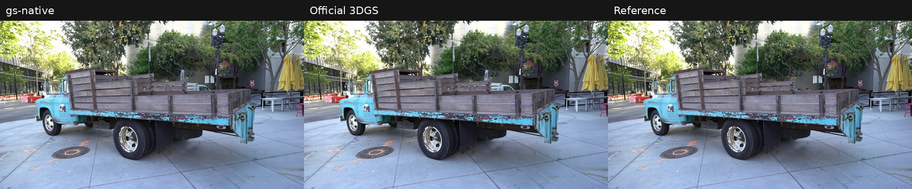

### train

Test view: `00001.jpg`.

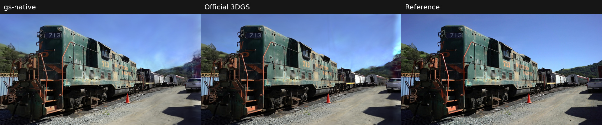

### drjohnson

Test view: `IMG_6292.jpg`.

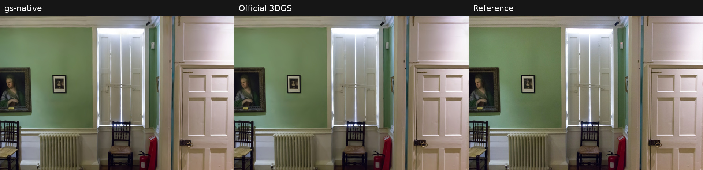

### playroom

Test view: `DSC05572.jpg`.

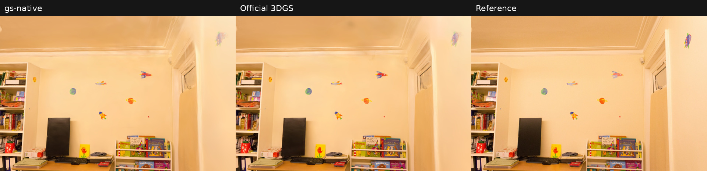

### bicycle

Test view: `_DSC8679.JPG`.

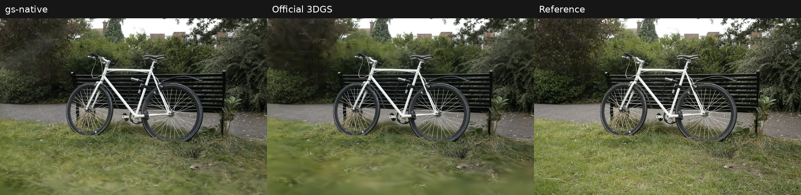

### bonsai

Test view: `DSCF5565.JPG`.

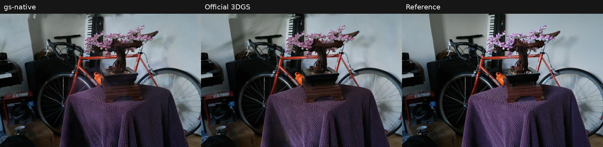

### counter

Test view: `DSCF5857.JPG`.

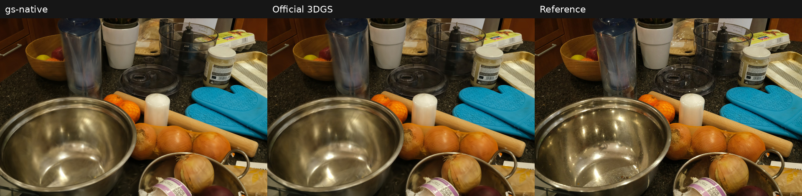

### garden

Test view: `DSC07956.JPG`.

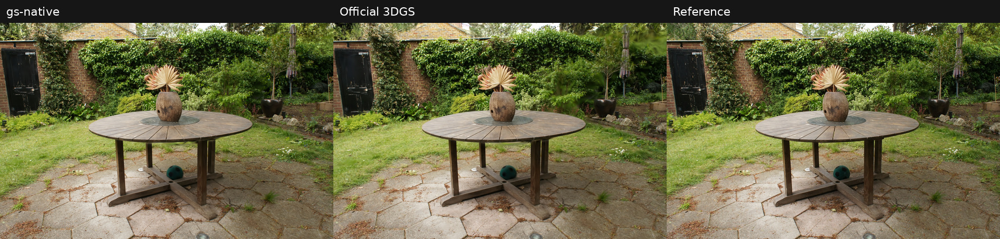

### kitchen

Test view: `DSCF0656.JPG`.

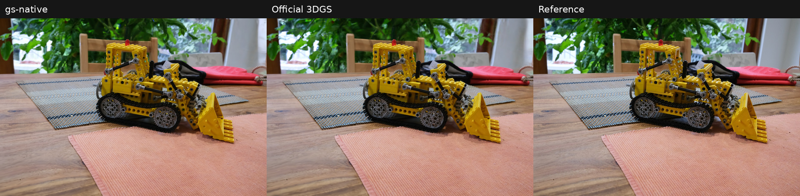

### room

Test view: `DSCF4667.JPG`.

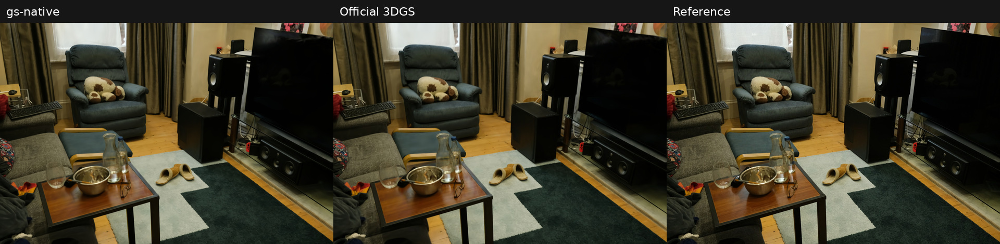

### stump

Test view: `_DSC9213.JPG`.

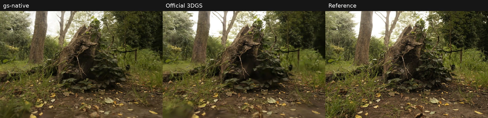

## Run provenance

Official source: [graphdeco-inria/gaussian-splatting](https://github.com/graphdeco-inria/gaussian-splatting), revision [54c035f7834b564019656c3e3fcc3646292f727d](https://github.com/graphdeco-inria/gaussian-splatting/tree/54c035f7834b564019656c3e3fcc3646292f727d). A test-side wrapper adds timing and final saving, suppresses TensorBoard/progress-bar overhead, and reports loss every 1,000 iterations. It does not replace the official optimization kernels.

| Run group | Retained run identifier | Code record |
|---|---|---|
| gs-native eleven scenes | 30,000 updates per scene | Tested revision a7c6115; later directory and fixed-seed changes are outside these runs |
| Official first four scenes | original_four_30000_20261112_001649 | Official 54c035f |
| Official bicycle | Separate 30,000-iteration run; run identifier not recorded in this report | Official 54c035f |
| Official bonsai | bonsai_original_30000_20261112_235850 | Official 54c035f |
| Official remaining five | remaining_five_original_30000_20261113_125550 | Official 54c035f |

The tables use the retained per-scene optimization times, final Gaussian counts and held-out-view metrics. gs-native uses its CUDA renderer for evaluation; the retained official results use the official renderer. Both use floating-point RGB clamped to [0, 1] and per-view mean metrics, with an 11 x 11 Gaussian SSIM kernel (sigma 1.5).

---

# gs-native vs. gsplat v1.5.3: 11-Scene Benchmark

This report is independent of the gs-native versus official 3DGS comparison above. It compares the retained gs-native runs with the retained 30,000-iteration gsplat v1.5.3 runs. Every scene has a final PLY model, optimization/evaluation logs, and verified held-out-view metrics.

## Scope and conclusions

- Observed per-scene ratios, calculated as gsplat time / gs-native time, range from **1.29x to 3.91x**. Bicycle records a 1.29x optimization speed ratio.
- Summed optimization time for these 11 runs is **9439.326 s (157.32 min)** for gs-native and **16120.364 s (268.67 min)** for gsplat. The ratio of those sums is **1.71x**, not an arithmetic mean of scene ratios.
- gs-native ends with fewer Gaussians than gsplat on all 11 scenes. Quality differences are measured at unequal model sizes; counts and signed PSNR/SSIM differences are included below alongside the timing results.
- Results apply to the pinned release and listed configurations; hardware and implementation details are documented below.
- Each scene was measured once; run-to-run variability was not evaluated.

## Test conditions

| Item | Configuration |
|---|---|
| GPU | One NVIDIA GeForce RTX 4090, 24 GB, per run |
| OS and CUDA toolkit | Ubuntu 22.04; CUDA 12.4 |
| gs-native instance | RTX 4090, driver 580.142; CPU model not retained |
| gsplat instance | Intel Xeon Platinum 8358P; 16 allocated CPU cores and 120 GB RAM |
| gsplat Python environment | PyTorch 2.5.1+cu124; NumPy 1.26.4; NVIDIA driver 580.105.08 |
| gsplat version | v1.5.3, revision `937e29912570c372bed6747a5c9bf85fed877bae` |
| Iteration budget | 30,000 single-camera iterations; both final models saved after all updates |
| Input resolution | Original supplied `images/` files; factor/downscale 1 |
| Split | Sorted filenames; indices 0, 8, 16, ... held out for testing |
| Appearance | Black background; SH degree increases from 0 to 3 every 1,000 iterations |
| Loss | L1 + SSIM, SSIM weight 0.2; implementation backends differ |
| gsplat optimizer | Ordinary Adam; no sparse gradients or selective/visible Adam |
| gsplat strategy | `DefaultStrategy`; refinement until iteration 15,000, opacity reset every 3,000 iterations during refinement |
| Opacity learning rate | gs-native 0.025; gsplat 0.05 |
| gsplat world normalization | Disabled; the example's default is enabled. Original COLMAP coordinates are retained for evaluation |
| Additional gsplat options | Dense rendering (`packed=False`); antialiasing, pose/appearance/depth optimization, and bilateral grids disabled |
| Evaluation | Full-resolution floating-point RGB, held-out-view mean PSNR and SSIM |

Both sets used RTX 4090 on different instances. The gs-native runs used driver 580.142; their CPU model and per-run clock histories were not retained. The gsplat runs were executed sequentially, without concurrent optimization or an interactive rendering service. The v1.5.3 CUDA/Python source tree was checked for local changes and remained unchanged.

### Image residency and implementation differences

- gs-native retains uint8 RGB source images in host memory and uploads the current target for each iteration.
- The gsplat test driver preloads the example dataset's unchanged float32 image outputs into CPU RAM before timing. Its existing DataLoader and per-frame GPU upload remain in use. It does not decode JPEGs from disk repeatedly inside the measured loop.
- These image-transfer dtypes and byte counts differ. Per-frame uploads are included in the loop time; initial loading and preloading are excluded.
- gs-native uses axis-angle rotations and its own analytic CUDA gradient/update implementation. gsplat uses quaternions, its CUDA rasterizer, PyTorch Adam, and `DefaultStrategy`.
- Opacity learning rates and population-control implementations are not matched. In particular, gsplat v1.5.3 defaults to `refine_scale2d_stop_iter=0`, disabling its optional screen-size refinement/pruning path. Other differences, including initialization, coordinate parameterization, and loss boundary handling, can also affect the trajectory.
- World-space normalization is disabled in gsplat to retain the original COLMAP coordinates; its example default enables normalization.

## Scenes and camera counts

Each run checks its actual dimensions, training/test counts, and complete held-out filename list against the retained gs-native reference before optimization. The evaluation-view names are checked again after evaluation.

| Scene | Dataset | Actual resolution | Total cameras | Training cameras | Test cameras |
|---|---|---:|---:|---:|---:|
| truck | Tanks and Temples | 979 x 546 | 251 | 219 | 32 |
| train | Tanks and Temples | 980 x 545 | 301 | 263 | 38 |
| drjohnson | Deep Blending | 1332 x 876 | 263 | 230 | 33 |
| playroom | Deep Blending | 1264 x 832 | 225 | 196 | 29 |
| bicycle | Mip-NeRF 360 | 4946 x 3286 | 194 | 169 | 25 |
| bonsai | Mip-NeRF 360 | 3118 x 2078 | 292 | 255 | 37 |
| counter | Mip-NeRF 360 | 3115 x 2076 | 240 | 210 | 30 |
| garden | Mip-NeRF 360 | 5187 x 3361 | 185 | 161 | 24 |
| kitchen | Mip-NeRF 360 | 3115 x 2078 | 279 | 244 | 35 |
| room | Mip-NeRF 360 | 3114 x 2075 | 311 | 272 | 39 |
| stump | Mip-NeRF 360 | 4978 x 3300 | 125 | 109 | 16 |

Full resolution means no further downscaling of the supplied files; it does not assert the original camera sensor resolution.

## Optimization time

gs-native uses OpenCV `TickMeter` around `Train()`, which synchronizes CUDA before returning. The gsplat driver uses `time.perf_counter()` around `Runner.train()` with CUDA synchronization at the timing boundaries. A forward/backward warmup is performed before the gsplat timer without an optimizer update, and its gradients are cleared before the 30,000-step loop.

The timers include the loop's rendering, loss/gradient computation, Adam updates, density control, opacity reset, image transfers, and retained logging. Loading, initialization, preloading, warmup, model saving, and evaluation are excluded. Intermediate evaluation, video rendering, TensorBoard output, and in-loop checkpoint/PLY saving are disabled for the gsplat measurement. Final PLY export runs after the timer and after the final parameter update.

| Scene | gs-native time | gsplat time | gs-native ms/iteration | gsplat ms/iteration | gsplat / gs-native |
|---|---:|---:|---:|---:|---:|
| truck | 252.127 s (4.20 min) | 985.690 s (16.43 min) | 8.4042 | 32.8563 | 3.91x |
| train | 205.840 s (3.43 min) | 587.017 s (9.78 min) | 6.8613 | 19.5672 | 2.85x |
| drjohnson | 376.533 s (6.28 min) | 1234.617 s (20.58 min) | 12.5511 | 41.1539 | 3.28x |
| playroom | 269.792 s (4.50 min) | 823.625 s (13.73 min) | 8.9931 | 27.4542 | 3.05x |
| bicycle | 2008.770 s (33.48 min) | 2593.519 s (43.23 min) | 66.9590 | 86.4506 | 1.29x |
| bonsai | 574.646 s (9.58 min) | 1032.526 s (17.21 min) | 19.1549 | 34.4175 | 1.80x |
| counter | 728.755 s (12.15 min) | 1098.318 s (18.31 min) | 24.2918 | 36.6106 | 1.51x |
| garden | 2238.230 s (37.30 min) | 3260.747 s (54.35 min) | 74.6077 | 108.6916 | 1.46x |
| kitchen | 782.867 s (13.05 min) | 1261.177 s (21.02 min) | 26.0956 | 42.0392 | 1.61x |
| room | 748.896 s (12.48 min) | 1110.150 s (18.50 min) | 24.9632 | 37.0050 | 1.48x |
| stump | 1252.870 s (20.88 min) | 2132.978 s (35.55 min) | 41.7623 | 71.0993 | 1.70x |

**Ratio = gsplat time / gs-native time.** A ratio above 1 means the recorded gs-native run took less time. Means in this table are recorded total / 30,000. Ratios use the stored precision before display rounding. gs-native totals were printed with limited precision; trailing zeros do not imply additional measurement accuracy. Timing ratios describe the recorded runs; repeated-run variability was not measured.

## Final model size and quality

Both final PLY files are evaluated at the dimensions listed above using floating-point RGB. Clamp RGB to `[0, 1]`, compute PSNR from RGB mean squared error, calculate SSIM with an 11 x 11 Gaussian kernel (sigma 1.5), and average over the held-out views. These are not gsplat's example TorchMetrics or 8-bit PNG metrics. LPIPS is not reported.

| Scene | gs-native Gaussians | gsplat Gaussians | gs-native PSNR (dB) | gsplat PSNR (dB) | Delta PSNR (dB) | gs-native SSIM | gsplat SSIM | Delta SSIM |
|---|---:|---:|---:|---:|---:|---:|---:|---:|
| truck | 1,580,419 | 3,762,190 | 25.5874 | 25.1161 | +0.4713 | 0.887587 | 0.879758 | +0.007829 |
| train | 902,374 | 1,856,137 | 21.9866 | 20.9993 | +0.9873 | 0.820169 | 0.812793 | +0.007375 |
| drjohnson | 2,513,212 | 5,147,004 | 29.1558 | 28.1844 | +0.9714 | 0.902705 | 0.888275 | +0.014430 |
| playroom | 1,491,373 | 3,144,534 | 30.1301 | 29.4808 | +0.6493 | 0.909798 | 0.903527 | +0.006271 |
| bicycle | 3,298,225 | 4,137,869 | 24.2821 | 23.7803 | +0.5018 | 0.716694 | 0.699190 | +0.017504 |
| bonsai | 832,043 | 1,600,256 | 31.6687 | 32.0566 | -0.3880 | 0.935875 | 0.937418 | -0.001543 |
| counter | 780,887 | 1,437,767 | 28.9600 | 28.9876 | -0.0276 | 0.912322 | 0.913977 | -0.001656 |
| garden | 4,439,664 | 6,325,654 | 26.4129 | 26.0466 | +0.3663 | 0.794868 | 0.785392 | +0.009477 |
| kitchen | 1,072,247 | 1,847,067 | 31.4130 | 31.1271 | +0.2859 | 0.921788 | 0.922368 | -0.000579 |
| room | 944,585 | 1,810,729 | 31.2482 | 31.1129 | +0.1352 | 0.914543 | 0.914751 | -0.000208 |
| stump | 2,323,116 | 2,871,196 | 26.1753 | 25.6666 | +0.5087 | 0.795514 | 0.785330 | +0.010183 |

**Delta = gs-native minus gsplat.** Positive means a higher metric for gs-native. Counts are final PLY Gaussian counts, verified against both the saved model header and the evaluation result.

### Interpretation

- gs-native has higher PSNR on 9 of 11 scenes and higher SSIM on 7 of 11 scenes in this set.
- Bicycle takes 33.48 minutes versus 43.23 minutes, with PSNR higher by 0.502 dB and SSIM higher by 0.017504.
- Bonsai and counter have lower gs-native PSNR; quality differences remain scene-dependent.
- gs-native has fewer final Gaussians on every scene in this set. Intermediate populations, visibility and projected footprints also affect timing.
- These results compare the configurations documented above.

## Run provenance

Source: [nerfstudio-project/gsplat, pinned v1.5.3 revision](https://github.com/nerfstudio-project/gsplat/tree/937e29912570c372bed6747a5c9bf85fed877bae). The test-side driver uses the release's example optimizer and rendering code. A copy of the example is adjusted in memory to move final saving after the timed loop; the upstream source files and CUDA kernels are not edited. Viewer, TensorBoard, intermediate evaluation, and unused LPIPS construction are suppressed. The optimization loss remains L1 + fused SSIM.

| Run group | Retained run identifier | Record |
|---|---|---|
| gsplat bonsai | `bonsai_30000_20261113_225042` | v1.5.3 / `937e29912570c372bed6747a5c9bf85fed877bae` |
| gsplat other ten scenes | `remaining_ten_30000_20261113_231437` | Same source/configuration; scenes executed serially |
| gs-native eleven scenes | 30,000 updates per scene | Tested revision a7c6115; later directory and fixed-seed changes are outside these runs |

The retained gsplat records include `training.log`, `evaluation.log`, `timing.json`, `metrics.json`, `run_metadata.json`, configuration, and final PLY files. The ten-scene batch also retains stage exit codes, a JSONL summary, and `verified_eleven_scene_results.json`. All optimization/evaluation stages completed successfully; all 11 model headers, camera lists, dimensions, iteration counts, and averaged metrics passed the final consistency checks. The gs-native results use the tested revision recorded above.
