# gs-native vs. Official 3DGS: 11-Scene Benchmark

This report compares existing 30,000-iteration runs of gs-native and the official Graphdeco Python 3DGS implementation. Every scene has a saved model and a completed held-out-view evaluation. No failed or unfinished run is included.

## Scope and conclusions

- Observed per-scene optimization speed ratios range from **2.10x to 5.24x**, calculated as official time / gs-native time.
- Summed optimization time for these 11 runs is **11672.559 s (194.54 min)** for gs-native and **46209.305 s (770.16 min)** for official 3DGS. The ratio of those sums is **3.96x**; it is not the arithmetic mean of scene ratios.
- Image quality is close on many scenes, but is not identical. In particular, gs-native is 0.461 dB lower on train; on garden its PSNR is higher while its SSIM is lower. See all signed differences below.
- These are single-run, historical system measurements. Hardware-instance and image-transfer differences are disclosed below. The speed ratios do not isolate CUDA kernel efficiency or establish a statistically repeatable advantage.

## Test conditions

| Item | Configuration |
|---|---|
| GPU | One NVIDIA GeForce RTX 4090, 24 GB |
| OS and CUDA toolkit | Ubuntu 22.04.4 LTS; CUDA 12.4 |
| Earlier instance | Intel Xeon Platinum 8352V; 16 allocated CPU cores and 120 GB RAM |
| Later instance | Intel Xeon Platinum 8358P; 16 allocated CPU cores and 120 GB RAM |
| Earlier-instance runs | All gs-native runs; official truck, train, drjohnson, playroom, bicycle, and bonsai |
| Later-instance runs | Official counter, garden, kitchen, room, and stump |
| Later-instance Python environment | PyTorch 2.5.1+cu124; CUDA runtime 12.4; NVIDIA driver 580.105.08 |
| Iteration budget | 30,000 single-camera iterations per run |
| Input resolution | Actual images/ files, downscale=1; no automatic 1600-pixel resize |
| Split | Sort image names; indices 0, 8, 16, ... held out for testing |
| Appearance | Black background; SH degree increases from 0 to 3 |
| Official optimizer/loss backend | Default Adam; fused SSIM enabled; sparse Adam unavailable |
| Evaluation | Same official renderer and evaluator within each paired comparison |

The two instances have the same GPU model, but different CPUs. Earlier driver details were not archived with every run. This is not a claim of identical machines or identical clock histories. The five later official runs were executed sequentially, without concurrent training or an interactive rendering service.

### Image residency and implementation differences

- gs-native stores source images on the host and uploads the current uint8 RGB target for each iteration.
- Official truck, train, drjohnson, and playroom used the default CUDA image residency. Official bicycle, bonsai, counter, garden, kitchen, room, and stump used --data_device cpu, which transfers the current floating-point target to the GPU.
- These are different image-transfer paths and byte counts. Uploads performed inside the optimization loop are included in the reported times; initial image loading/preloading is excluded. The comparison is of the tested systems, not identical data-transfer implementations.
- gs-native uses axis-angle rotations and performs Adam before density control. The official implementation uses quaternions and its own update/densification order. Final-image clamping and the alpha-cap derivative also differ. There is no bitwise-equivalence claim.
- Both run a nominal 30,000-iteration schedule. The official loop skips the optimizer step at its final iteration, whereas gs-native updates at every iteration.

## Scenes and camera counts

Camera counts below come from COLMAP records. Each pair's complete held-out-view name lists were checked for exact agreement with one another and with the expected split.

| Scene | Dataset | Actual resolution | Total cameras | Training cameras | Test cameras |
|---|---|---:|---:|---:|---:|
| truck | Tanks and Temples | 979 x 546 | 251 | 219 | 32 |
| train | Tanks and Temples | 980 x 545 | 301 | 263 | 38 |
| drjohnson | Deep Blending | 1332 x 876 | 263 | 230 | 33 |
| playroom | Deep Blending | 1264 x 832 | 225 | 196 | 29 |
| bicycle | Mip-NeRF 360 | 4946 x 3286 | 194 | 169 | 25 |
| bonsai | Mip-NeRF 360 | 3118 x 2078 | 292 | 255 | 37 |
| counter | Mip-NeRF 360 | 3115 x 2076 | 240 | 210 | 30 |
| garden | Mip-NeRF 360 | 5187 x 3361 | 185 | 161 | 24 |
| kitchen | Mip-NeRF 360 | 3115 x 2078 | 279 | 244 | 35 |
| room | Mip-NeRF 360 | 3114 x 2075 | 311 | 272 | 39 |
| stump | Mip-NeRF 360 | 4978 x 3300 | 125 | 109 | 16 |

The first four scenes use the image sizes supplied in the COLMAP dataset package; full resolution here means no further downscaling of those files, not the original camera sensor resolution.

## Optimization time

gs-native uses OpenCV TickMeter around Train(), which synchronizes CUDA before returning. The official timing wrapper uses time.perf_counter() with CUDA synchronization at both boundaries. Both timings include rendering, loss/gradient computation, parameter updates, density control, opacity reset, and logging executed inside their loops. Scene loading, initialization, final model saving, and evaluation are excluded. Periodic checkpoint/model saving and intermediate evaluation were disabled for the official timing run; final model saving was performed after stopping its optimization timer.

| Scene | gs-native time | Official 3DGS time | gs-native ms/iteration | Official ms/iteration | Official / gs-native |
|---|---:|---:|---:|---:|---:|
| truck | 356.907 s (5.95 min) | 788.970 s (13.15 min) | 11.8969 | 26.2990 | 2.21x |
| train | 312.585 s (5.21 min) | 655.577 s (10.93 min) | 10.4195 | 21.8526 | 2.10x |
| drjohnson | 539.596 s (8.99 min) | 1413.095 s (23.55 min) | 17.9865 | 47.1032 | 2.62x |
| playroom | 374.733 s (6.25 min) | 1041.503 s (17.36 min) | 12.4911 | 34.7168 | 2.78x |
| bicycle | 2593.510 s (43.23 min) | 9379.895 s (156.33 min) | 86.4503 | 312.6632 | 3.62x |
| bonsai | 720.258 s (12.00 min) | 3564.527 s (59.41 min) | 24.0086 | 118.8176 | 4.95x |
| counter | 943.650 s (15.73 min) | 3954.168 s (65.90 min) | 31.4550 | 131.8056 | 4.19x |
| garden | 2486.610 s (41.44 min) | 10005.353 s (166.76 min) | 82.8870 | 333.5118 | 4.02x |
| kitchen | 1035.550 s (17.26 min) | 4395.360 s (73.26 min) | 34.5183 | 146.5120 | 4.24x |
| room | 1005.790 s (16.76 min) | 4177.453 s (69.62 min) | 33.5263 | 139.2484 | 4.15x |
| stump | 1303.370 s (21.72 min) | 6833.404 s (113.89 min) | 43.4457 | 227.7801 | 5.24x |

Mean milliseconds per iteration are calculated from the recorded total / 30,000. Ratios and differences use the recorded precision before display rounding. gs-native totals were printed with limited precision by its demo, so their extra trailing zeros do not imply additional measurement accuracy.

## Final model size and quality

For each scene, evaluate both final PLY files using the same official 3DGS rendering pipeline at the full dimensions listed above. Clamp floating-point RGB to [0, 1], calculate PSNR from RGB mean squared error, and use utils.loss_utils.ssim for SSIM. Average per-view metrics over all held-out views. These are not the quantized-PNG PSNR values produced by the C++ render demo.

| Scene | gs-native Gaussians | Official Gaussians | gs-native PSNR (dB) | Official PSNR (dB) | Delta PSNR (dB) | gs-native SSIM | Official SSIM | Delta SSIM |
|---|---:|---:|---:|---:|---:|---:|---:|---:|
| truck | 2,017,089 | 2,061,061 | 25.4658 | 25.3787 | +0.0871 | 0.885331 | 0.885385 | -0.000054 |
| train | 1,057,078 | 1,095,237 | 22.0307 | 22.4914 | -0.4607 | 0.821593 | 0.824078 | -0.002485 |
| drjohnson | 3,139,738 | 3,115,762 | 29.3618 | 29.3680 | -0.0061 | 0.905442 | 0.905500 | -0.000058 |
| playroom | 1,832,144 | 1,836,194 | 30.2406 | 30.1570 | +0.0836 | 0.909664 | 0.909820 | -0.000156 |
| bicycle | 2,532,913 | 2,788,896 | 23.7879 | 23.7921 | -0.0042 | 0.694428 | 0.697761 | -0.003333 |
| bonsai | 933,231 | 932,925 | 31.9468 | 32.0156 | -0.0688 | 0.936006 | 0.935844 | +0.000162 |
| counter | 925,169 | 951,709 | 28.9318 | 28.9199 | +0.0118 | 0.911815 | 0.911987 | -0.000172 |
| garden | 3,922,080 | 4,188,240 | 26.0180 | 25.7755 | +0.2425 | 0.779618 | 0.782932 | -0.003314 |
| kitchen | 1,361,337 | 1,403,971 | 31.1441 | 31.2369 | -0.0929 | 0.920823 | 0.920976 | -0.000153 |
| room | 1,096,531 | 1,111,573 | 31.2178 | 31.1446 | +0.0732 | 0.913926 | 0.914235 | -0.000309 |
| stump | 2,078,762 | 2,118,174 | 25.5644 | 25.6627 | -0.0983 | 0.781777 | 0.783590 | -0.001814 |

**Delta = gs-native minus official 3DGS.** Positive means a higher metric for gs-native. Counts are final PLY Gaussian counts, not averages over the optimization trajectory.

### Interpretation

- train has the largest observed PSNR loss for gs-native (-0.461 dB); it should not be described as equal quality.
- garden has a higher gs-native PSNR (+0.242 dB) but lower SSIM (-0.003314). The metrics do not support declaring one reconstruction uniformly better.
- bonsai has nearly identical final counts (933,231 vs. 932,925), a PSNR difference of -0.069 dB, and an observed time ratio of 4.95x on the earlier instance.
- Most pairs have similar final model sizes, but final counts do not prove equal work: intermediate counts, visibility, projected footprint sizes, memory traffic, and implementation paths can differ.
- No repeated-run variance or confidence interval is available. A small metric difference does not establish a systematic quality advantage.

## Matched-view previews

Each row below shows **gs-native | official 3DGS | reference image**, using the first filename-sorted held-out camera. Views were selected deterministically, not by visual quality. Both models were rendered with the same official renderer at their full evaluation resolution, then resized to 640 pixels per panel for documentation. JPEG previews are illustrative; the numerical evaluation uses full-resolution floating-point images and is not recomputed from these JPEGs. These comparisons visualize the saved models and do not benchmark the native C++ renderer.

### truck

Test view: `000001.jpg`.

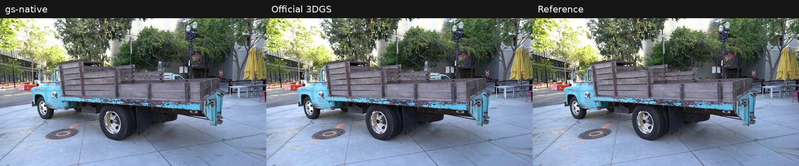

### train

Test view: `00001.jpg`.

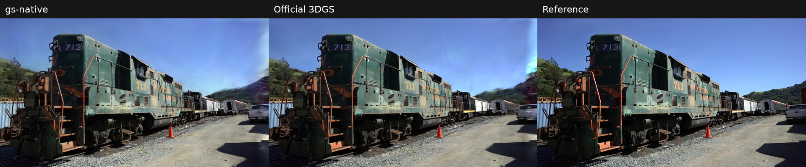

### drjohnson

Test view: `IMG_6292.jpg`.

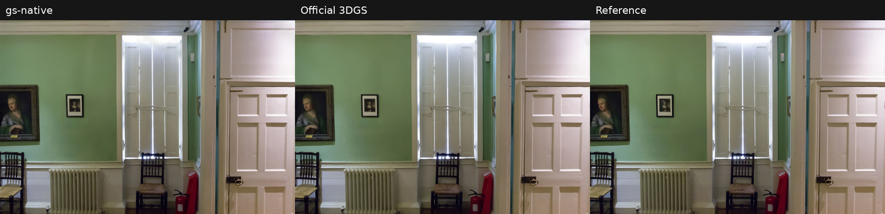

### playroom

Test view: `DSC05572.jpg`.

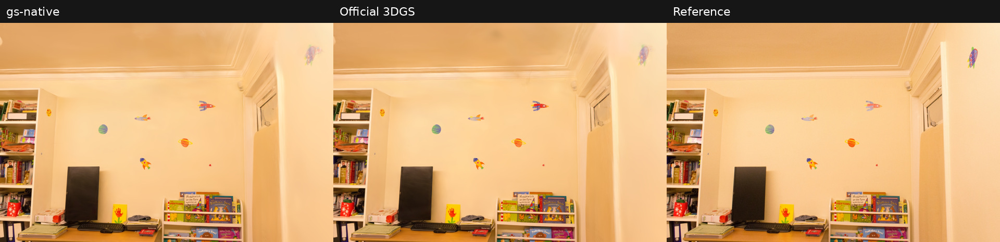

### bicycle

Test view: `_DSC8679.JPG`.

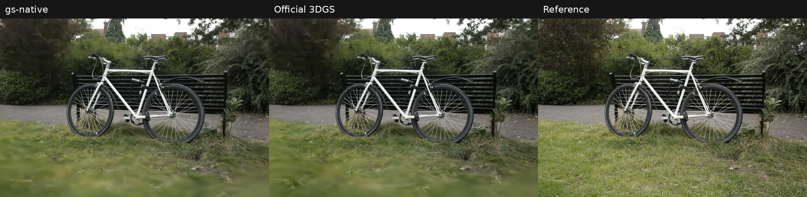

### bonsai

Test view: `DSCF5565.JPG`.

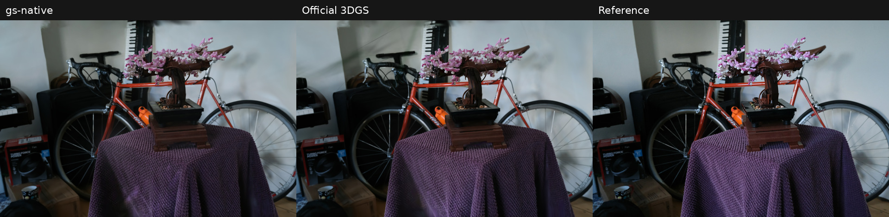

### counter

Test view: `DSCF5857.JPG`.

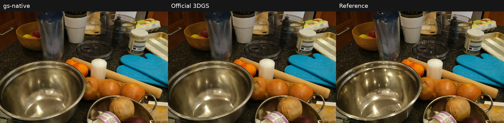

### garden

Test view: `DSC07956.JPG`.

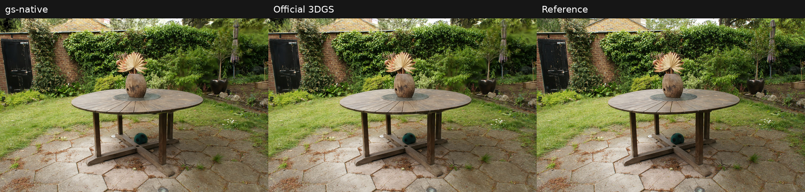

### kitchen

Test view: `DSCF0656.JPG`.

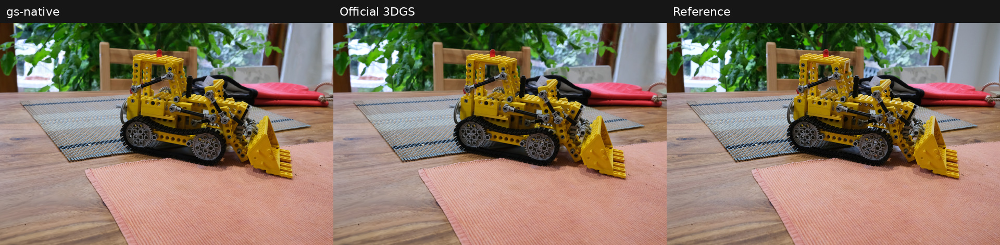

### room

Test view: `DSCF4667.JPG`.

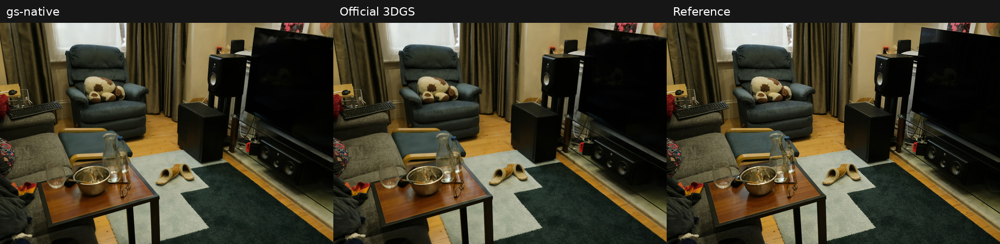

### stump

Test view: `_DSC9213.JPG`.

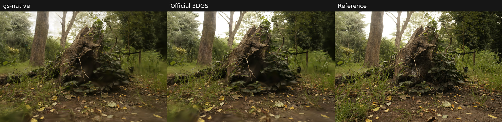

## Run provenance

Official source: [graphdeco-inria/gaussian-splatting](https://github.com/graphdeco-inria/gaussian-splatting), revision [54c035f7834b564019656c3e3fcc3646292f727d](https://github.com/graphdeco-inria/gaussian-splatting/tree/54c035f7834b564019656c3e3fcc3646292f727d). A test-side wrapper adds timing and final saving, suppresses TensorBoard/progress-bar overhead, and reports loss every 1,000 iterations. It does not replace the official optimization kernels.

| Run group | Retained run identifier | Code record |
|---|---|---|
| gs-native first four scenes | sgs_four_30000_20261111_234622 | Archived f235c153ada55323bca56a5420311ff240893924 |
| Official first four scenes | original_four_30000_20261112_001649 | Official 54c035f |
| bicycle pair | bicycle_full_compare_20261112_012452 | Historical binary run; gs-native training revision was not separately recorded |
| gs-native bonsai | bonsai_30000_20261112_210444 | Pre-public-history binary; same core as archived 65aaa2a |
| Official bonsai | bonsai_original_30000_20261112_235850 | Official 54c035f |
| gs-native remaining five | remaining_five_30000_20261112_214936 | Archived 65aaa2a732d32f1e38e2ad130455a301590ac95a |
| Official remaining five | remaining_five_original_30000_20261113_125550 | Official 54c035f |

Original per-run training.log, evaluation.log, metrics.json, and final PLY files were retained on the benchmark server. All 11 pairs have matching evaluation-view lists. This document transcribes the stored results; it is not a new training run of the public repository snapshot. Archived gs-native commit IDs refer to the history retained in the pre-publication backup and are no longer reachable through the rewritten public main branch.

---

# gs-native vs. gsplat v1.5.3: 11-Scene Benchmark

This report is independent of the gs-native versus official 3DGS comparison above. It compares the retained gs-native runs with new 30,000-iteration gsplat v1.5.3 runs. Every scene has a final PLY model, optimization/evaluation logs, and verified held-out-view metrics.

## Scope and conclusions

- Observed per-scene ratios, calculated as gsplat time / gs-native time, range from **1.00x to 2.76x**. Bicycle has effectively equal recorded optimization times; the displayed 1.00x ratio should be treated as a tie.
- Summed optimization time for these 11 runs is **11672.559 s (194.54 min)** for gs-native and **16120.364 s (268.67 min)** for gsplat. The ratio of those sums is **1.38x**, not an arithmetic mean of scene ratios.
- Final Gaussian populations and quality differ. Counts and signed PSNR/SSIM differences are included below, so the time ratios can be read together with the reconstruction results.
- These are single-run system measurements on different hardware instances with the same GPU model. Configuration and data-transfer differences are documented below. Results apply to the pinned release and tested configuration, without a claim of bitwise-equivalent optimization or identical workloads.

## Test conditions

| Item | Configuration |
|---|---|
| GPU | One NVIDIA GeForce RTX 4090, 24 GB, per run |
| OS and CUDA toolkit | Ubuntu 22.04.4 LTS; CUDA 12.4 |
| gs-native instance | Intel Xeon Platinum 8352V; 16 allocated CPU cores and 120 GB RAM |
| gsplat instance | Intel Xeon Platinum 8358P; 16 allocated CPU cores and 120 GB RAM |
| gsplat Python environment | PyTorch 2.5.1+cu124; NumPy 1.26.4; NVIDIA driver 580.105.08 |
| gsplat version | v1.5.3, revision `937e29912570c372bed6747a5c9bf85fed877bae` |
| Iteration budget | 30,000 single-camera iterations; both final models saved after all updates |
| Input resolution | Original supplied `images/` files; factor/downscale 1 |
| Split | Sorted filenames; indices 0, 8, 16, ... held out for testing |
| Appearance | Black background; SH degree increases from 0 to 3 every 1,000 iterations |
| Loss | L1 + SSIM, SSIM weight 0.2; implementation backends differ |
| gsplat optimizer | Ordinary Adam; no sparse gradients or selective/visible Adam |
| gsplat strategy | `DefaultStrategy`; refinement until iteration 15,000, opacity reset every 3,000 iterations during refinement |
| Opacity learning rate | gs-native 0.025; gsplat 0.05 |
| gsplat world normalization | Disabled; the example's default is enabled. Original COLMAP coordinates are retained for the shared evaluator |
| Additional gsplat options | Dense rendering (`packed=False`); antialiasing, pose/appearance/depth optimization, and bilateral grids disabled |
| Evaluation | Same floating-point rendering/evaluation pipeline for the two final PLY models |

Both platforms use the same GPU model, but the CPU and physical instance differ. Driver/clock histories of the older gs-native runs were not archived for every scene. The gsplat runs were executed sequentially, without concurrent optimization or an interactive rendering service. The v1.5.3 CUDA/Python source tree was checked for local changes and remained unchanged.

### Image residency and implementation differences

- gs-native retains uint8 RGB source images in host memory and uploads the current target for each iteration.
- The gsplat test driver preloads the example dataset's unchanged float32 image outputs into CPU RAM before timing. Its existing DataLoader and per-frame GPU upload remain in use. It does not decode JPEGs from disk repeatedly inside the measured loop.
- These image-transfer dtypes and byte counts differ. Per-frame uploads are included in the loop time; initial loading and preloading are excluded.
- gs-native uses axis-angle rotations and its own analytic CUDA gradient/update implementation. gsplat uses quaternions, its CUDA rasterizer, PyTorch Adam, and `DefaultStrategy`.
- Opacity learning rates and population-control implementations are not matched. In particular, gsplat v1.5.3 defaults to `refine_scale2d_stop_iter=0`, disabling its optional screen-size refinement/pruning path. Other differences, including initialization, coordinate parameterization, and loss boundary handling, can also affect the trajectory.
- World-space normalization is explicitly disabled in gsplat; this is a deliberate override of its example default. These measurements describe that configuration, rather than establishing the best achievable quality/performance for every gsplat configuration or for its current main branch.

## Scenes and camera counts

Each run checks its actual dimensions, training/test counts, and complete held-out filename list against the retained gs-native reference before optimization. The evaluation-view names are checked again after evaluation.

| Scene | Dataset | Actual resolution | Total cameras | Training cameras | Test cameras |
|---|---|---:|---:|---:|---:|
| truck | Tanks and Temples | 979 x 546 | 251 | 219 | 32 |
| train | Tanks and Temples | 980 x 545 | 301 | 263 | 38 |
| drjohnson | Deep Blending | 1332 x 876 | 263 | 230 | 33 |
| playroom | Deep Blending | 1264 x 832 | 225 | 196 | 29 |
| bicycle | Mip-NeRF 360 | 4946 x 3286 | 194 | 169 | 25 |
| bonsai | Mip-NeRF 360 | 3118 x 2078 | 292 | 255 | 37 |
| counter | Mip-NeRF 360 | 3115 x 2076 | 240 | 210 | 30 |
| garden | Mip-NeRF 360 | 5187 x 3361 | 185 | 161 | 24 |
| kitchen | Mip-NeRF 360 | 3115 x 2078 | 279 | 244 | 35 |
| room | Mip-NeRF 360 | 3114 x 2075 | 311 | 272 | 39 |
| stump | Mip-NeRF 360 | 4978 x 3300 | 125 | 109 | 16 |

Full resolution means no further downscaling of the supplied files; it does not assert the original camera sensor resolution.

## Optimization time

gs-native uses OpenCV `TickMeter` around `Train()`, which synchronizes CUDA before returning. The gsplat driver uses `time.perf_counter()` around `Runner.train()` with CUDA synchronization at the timing boundaries. A forward/backward warmup is performed before the gsplat timer without an optimizer update, and its gradients are cleared before the 30,000-step loop.

The timers include the loop's rendering, loss/gradient computation, Adam updates, density control, opacity reset, image transfers, and retained logging. Loading, initialization, preloading, warmup, model saving, and evaluation are excluded. Intermediate evaluation, video rendering, TensorBoard output, and in-loop checkpoint/PLY saving are disabled for the gsplat measurement. Final PLY export runs after the timer and after the final parameter update.

| Scene | gs-native time | gsplat time | gs-native ms/iteration | gsplat ms/iteration | gsplat / gs-native |
|---|---:|---:|---:|---:|---:|
| truck | 356.907 s (5.95 min) | 985.690 s (16.43 min) | 11.8969 | 32.8563 | 2.76x |
| train | 312.585 s (5.21 min) | 587.017 s (9.78 min) | 10.4195 | 19.5672 | 1.88x |
| drjohnson | 539.596 s (8.99 min) | 1234.617 s (20.58 min) | 17.9865 | 41.1539 | 2.29x |
| playroom | 374.733 s (6.25 min) | 823.625 s (13.73 min) | 12.4911 | 27.4542 | 2.20x |
| bicycle | 2593.510 s (43.23 min) | 2593.519 s (43.23 min) | 86.4503 | 86.4506 | 1.00x |
| bonsai | 720.258 s (12.00 min) | 1032.526 s (17.21 min) | 24.0086 | 34.4175 | 1.43x |
| counter | 943.650 s (15.73 min) | 1098.318 s (18.31 min) | 31.4550 | 36.6106 | 1.16x |
| garden | 2486.610 s (41.44 min) | 3260.747 s (54.35 min) | 82.8870 | 108.6916 | 1.31x |
| kitchen | 1035.550 s (17.26 min) | 1261.177 s (21.02 min) | 34.5183 | 42.0392 | 1.22x |
| room | 1005.790 s (16.76 min) | 1110.150 s (18.50 min) | 33.5263 | 37.0050 | 1.10x |
| stump | 1303.370 s (21.72 min) | 2132.978 s (35.55 min) | 43.4457 | 71.0993 | 1.64x |

**Ratio = gsplat time / gs-native time.** A ratio above 1 means the recorded gs-native run took less time. Means in this table are recorded total / 30,000. Ratios use the stored precision before display rounding. gs-native totals were printed with limited precision; trailing zeros do not imply additional measurement accuracy. Small differences, especially bicycle's nearly equal totals, should not be interpreted as a repeatable speed advantage from one run.

## Final model size and quality

Both final PLY files are evaluated with the same shared floating-point renderer and metric implementation at the dimensions listed above. Clamp RGB to `[0, 1]`, compute PSNR from RGB mean squared error, calculate SSIM with `utils.loss_utils.ssim`, and average over the held-out views. These are not gsplat's example TorchMetrics or 8-bit PNG metrics. LPIPS is not reported.

| Scene | gs-native Gaussians | gsplat Gaussians | gs-native PSNR (dB) | gsplat PSNR (dB) | Delta PSNR (dB) | gs-native SSIM | gsplat SSIM | Delta SSIM |
|---|---:|---:|---:|---:|---:|---:|---:|---:|
| truck | 2,017,089 | 3,762,190 | 25.4658 | 25.1161 | +0.3497 | 0.885331 | 0.879758 | +0.005573 |
| train | 1,057,078 | 1,856,137 | 22.0307 | 20.9993 | +1.0314 | 0.821593 | 0.812793 | +0.008800 |
| drjohnson | 3,139,738 | 5,147,004 | 29.3618 | 28.1844 | +1.1775 | 0.905442 | 0.888275 | +0.017167 |
| playroom | 1,832,144 | 3,144,534 | 30.2406 | 29.4808 | +0.7598 | 0.909664 | 0.903527 | +0.006137 |
| bicycle | 2,532,913 | 4,137,869 | 23.7879 | 23.7803 | +0.0076 | 0.694428 | 0.699190 | -0.004762 |
| bonsai | 933,231 | 1,600,256 | 31.9468 | 32.0566 | -0.1099 | 0.936006 | 0.937418 | -0.001411 |
| counter | 925,169 | 1,437,767 | 28.9318 | 28.9876 | -0.0559 | 0.911815 | 0.913977 | -0.002162 |
| garden | 3,922,080 | 6,325,654 | 26.0180 | 26.0466 | -0.0286 | 0.779618 | 0.785392 | -0.005774 |
| kitchen | 1,361,337 | 1,847,067 | 31.1441 | 31.1271 | +0.0170 | 0.920823 | 0.922368 | -0.001544 |
| room | 1,096,531 | 1,810,729 | 31.2178 | 31.1129 | +0.1048 | 0.913926 | 0.914751 | -0.000824 |
| stump | 2,078,762 | 2,871,196 | 25.5644 | 25.6666 | -0.1022 | 0.781777 | 0.785330 | -0.003554 |

**Delta = gs-native minus gsplat.** Positive means a higher metric for gs-native. Counts are final PLY Gaussian counts, verified against both the saved model header and the evaluation result.

### Interpretation

- The largest gs-native PSNR advantage in this set is on **drjohnson (+1.177 dB)**; the largest deficit is on **bonsai (-0.110 dB)**. Quality should be assessed scene by scene, using both PSNR and SSIM.
- Bicycle's totals both round to **43.23 minutes**. Its PSNR differs by only **0.0076 dB**, while gsplat has the higher SSIM. These single-run times do not support declaring a timing winner for that scene.
- gsplat produces more final Gaussians on every scene in this set. Final counts are not the complete workload: intermediate populations, visibility, projected footprints, and memory traffic also matter.
- The timing results describe the selected implementations, configurations, and image-transfer paths. They do not establish how fast the two CUDA backends would be for an identical Gaussian state and workload, or prove that a particular learning rate caused a measured quality difference.

## Run provenance

Source: [nerfstudio-project/gsplat, pinned v1.5.3 revision](https://github.com/nerfstudio-project/gsplat/tree/937e29912570c372bed6747a5c9bf85fed877bae). The test-side driver uses the release's example optimizer and rendering code. A copy of the example is adjusted in memory to move final saving after the timed loop; the upstream source files and CUDA kernels are not edited. Viewer, TensorBoard, intermediate evaluation, and unused LPIPS construction are suppressed. The optimization loss remains L1 + fused SSIM.

| Run group | Retained run identifier | Record |
|---|---|---|
| gsplat bonsai | `bonsai_30000_20261113_225042` | v1.5.3 / `937e29912570c372bed6747a5c9bf85fed877bae` |
| gsplat other ten scenes | `remaining_ten_30000_20261113_231437` | Same source/configuration; scenes executed serially |
| gs-native first four scenes | `sgs_four_30000_20261111_234622` | Archived `f235c153ada55323bca56a5420311ff240893924` |
| gs-native bicycle | `bicycle_full_compare_20261112_012452` | Historical binary; its optimization revision was not separately recorded |
| gs-native bonsai | `bonsai_30000_20261112_210444` | Pre-public-history binary; same core as archived `65aaa2a` |
| gs-native other five scenes | `remaining_five_30000_20261112_214936` | Archived `65aaa2a732d32f1e38e2ad130455a301590ac95a` |

The retained gsplat records include `training.log`, `evaluation.log`, `timing.json`, `metrics.json`, `run_metadata.json`, configuration, and final PLY files. The ten-scene batch also retains stage exit codes, a JSONL summary, and `verified_eleven_scene_results.json`. All optimization/evaluation stages completed successfully; all 11 model headers, camera lists, dimensions, iteration counts, and averaged metrics passed the final consistency checks. Archived gs-native revisions refer to the retained pre-publication history backup.
